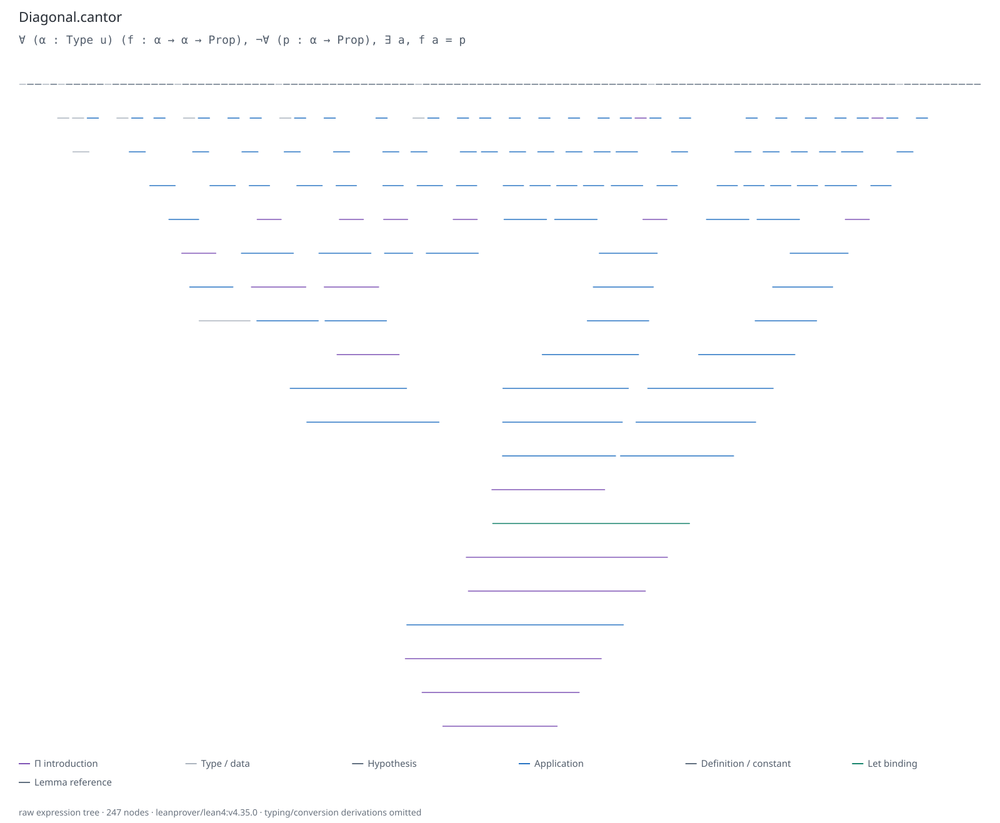

# Formality

[](https://github.com/elanroth/Formality/actions/workflows/ci.yml)

**See the shape of a Lean proof.**

Formality turns Lean proof terms into colored inference bars on a white background:
premises above, a narrow conclusion below, and no formulas inside the tree. Paste
Lean source, select a named theorem, expand lemmas, or specialize induction at a
concrete natural number. Export SVG, PNG, and inspectable JSON.



The image is generated from [this Lean proof](examples/Diagonal.lean). Colors
identify expression categories such as introduction, application, constructor,
recursor, and lemma reference. The underlying nodes retain terms and types for
inspection. No language model interprets the proof.

Formality is experimental. It exports **typed expression trees**, not complete
kernel typing or conversion derivations. See [the specification](SPEC.md) for the
exact traversal and reproducibility contract.

## Try it online

Open **[Formality](https://elanroth.github.io/formality/)**. Paste a named Lean
proof and select **Generate tree**, or start with Cantor's diagonal, concrete
induction, soundness, or Foundation's actual Gödel theorem. Download a PNG or SVG.

The website runs Lean locally in your browser; pasted source is not uploaded.
Its pinned WebAssembly runtime reports Lean **4.33.0** (commit
`62b6a2291302d4bbeace37642a066b7510d0145c`) and includes core libraries plus a
Mathlib subset. The first run downloads compiler/library assets and needs a modern
browser with shared WebAssembly memory. The native CLI pins **4.35.0** instead.
Foundation is a saved, kernel-checked example on the website: its depth 0/1/2
views contain 467 / 2,646 / 19,979 nodes. Regenerate it using the native CLI and
its pinned Foundation project. Arbitrary third-party projects are not bundled
with the website.

Browser JSON records a separate `lean-proof-tree/browser-contract/v1` provenance
record with source/exporter hashes and the pinned runtime asset manifest. It is
not a native replay lock. See [the browser deployment guide](docs/website.md).

## Install

Requires **Python 3.10+**, [Lean/elan](https://lean-lang.org/install/) on `PATH`,
and **Node.js 20+** for CLI SVG exports. There are no Python runtime dependencies.
The bundled examples pin **Lean 4.35.0**.

```sh
git clone https://github.com/elanroth/Formality.git
cd Formality
python3 -m venv .venv
. .venv/bin/activate
python -m pip install .
formality serve
```

Open <http://127.0.0.1:8765>. From a checkout, `python3 proof_tree.py` can replace
`formality` without installing the package. Use `--port 8766` to select another port.
The service runs locally and executes the supplied Lean source, including
elaborators and IO commands. Use source you trust.

The Python distribution is named `formality-lean`; its import and CLI are
`formality`. The prototype names `lean_proof_tree` and `lean-proof-tree` remain
compatibility aliases. Installation from PyPI is not currently provided.

## Give it a proof

Select a bundled example, open a `.lean` file, or paste a source file containing a
**named declaration**. An anonymous `example` has no stable name to select.

```lean
theorem compose (P Q R : Prop) (f : P → Q) (g : Q → R) (p : P) : R :=
  g (f p)
```

Enter `compose` and generate. The viewer offers:

- **Raw / compact:** full expression structure, or grouped applications with
  type/data arguments hidden.
- **Expand lemmas:** open selected declaration bodies or a bounded dependency depth.
- **Specialize induction:** set a top-level `Nat` binder, then enable normalization
  to compute recursors whose inputs are concrete. Symbolic recursors and opaque
  lemma calls can remain; normalization can also make a proof smaller.
- **Inspect and export:** click a bar for its term/type; save SVG, PNG, or JSON.
  Rule colors and line weights are configurable.

For a theorem in an existing Lean/Lake project, supply its folder and module names,
then leave source empty. Build dependencies and imported modules first. Formality
uses the project's `lean-toolchain` and `lake env lean`. Set
`FORMALITY_MATHLIB_PROJECT=/path/to/mathlib-project` to enable the bundled Mathlib
catalog entries. Other Lean versions can require adapting the metaprogramming API;
this is not a promise of compatibility with every Lean release.

## CLI and Python API

```sh
formality render --source examples/Diagonal.lean \
  --declaration Diagonal.cantor --expand Diagonal.selfContradiction \
  --output runs/cantor.json --svg runs/cantor.svg

formality render --source examples/Induction.lean \
  --declaration Induction.iterate --mode compact --nat n=20 --normalize \
  --output runs/induction20.json --svg runs/induction20.svg
```

```python
from formality import extract

tree = extract(
    source="theorem identity (P : Prop) (p : P) : P := p\n",
    declaration="identity",
    toolchain="leanprover/lean4:v4.35.0",
    mode="raw",
)
print(tree["contract"]["treeSha256"])
```

Other CLI options include `--project`, repeated `--module` and `--expand`,
`--expand-depth`, `--max-nodes`, `--max-depth`, `--max-visits`, `--lean-option pp.universes=true`,
and `--timeout`. Run `formality render --help` for details.

## Reproduce a tree

The same Lean source does not define a unique picture independently of the
compiler, libraries, elaboration options, expansion choices, traversal, and layout.
Formality makes those choices explicit in a versioned profile and lock.

```sh
formality export examples/cantor.profile.json \
  --output runs/first --write-lock runs/cantor.lock.json
formality export examples/cantor.profile.json \
  --output runs/replay --lock runs/cantor.lock.json
```

```python
from formality import export_profile
export_profile("examples/cantor.profile.json", "result", write_lock="cantor.lock.json")
export_profile("examples/cantor.profile.json", "replay", lock="cantor.lock.json")
```

A profile fixes source/imports, declaration, toolchain, Lean options, transformations,
traversal limits, and drawing settings. A lock additionally fingerprints the compiler,
actual imported artifacts, dependency revisions/configuration, implementation, and
result. Mismatches are rejected before the requested output bundle is written.
Locks cannot be created for truncated trees.

Exports contain `tree.json`, `tree.canonical.json`, `manifest.json`, `source.lean`,
`drawing.json`, and `proof.svg`. Use `--no-svg` for JSON-only exports without Node.
Run evidence is retained under ignored `runs/` in a checkout or
`~/.cache/formality/runs` when installed; override with `FORMALITY_RUNS`.
These files can contain your source and local paths. Review them before sharing.

Reproducibility tests compare **canonical tree bytes and SVG bytes** across fresh
Lean processes. PNG pixels depend on browser/fonts/platform. Locks verify an
existing environment; they do not install it or make arbitrary IO-using Lean
metaprograms hermetic. [SPEC.md](SPEC.md) defines the guarantees and limits.
The existing `lean-proof-tree/*/v1` schema identifiers remain unchanged.

## What is checked?

Expansion, specialization, and normalization operate on actual Lean expressions.
The transformed closed term is submitted as a fresh theorem to Lean's kernel.
The entire driver must succeed before extraction returns a result. Axiom
collection reports standard axioms, custom axioms, and `sorryAx`; a kernel-checked
term using `sorryAx` is still an admitted proof.

The extractor is not itself formally verified. It does not record every kernel
conversion judgment. Raw and compact trees are presentation policies; node counts
are not minimum proof complexity. Sharing is repeated as tree branches, so opening
many lemmas can grow quickly. Budgets produce explicit red dashed omitted-subtree
marks and a truncation flag. Timeouts fail with diagnostics.

## Why part of it is written in Lean

[The semantic core](lean/Exporter.lean) is a Lean metaprogram. Its callable
`ProofTreeTool.exportDeclaration : Config → Json → MetaM Json` API performs the
transformations, kernel submission, axiom collection, and traversal. The optional
JSON argument records configuration metadata. `#proof_tree` wraps it with JSON
parsing and file output. To use the core in your own driver, place `import Lean`
at the top, then include the exporter after your imports/declarations.

Python handles project selection, process isolation, fingerprints, CLI, and the
local server. JavaScript handles interactive layout and vector/browser exports.
This keeps the proof-facing code next to Lean's actual expression APIs. Writing a
metaprogram in Lean does not automatically prove its correctness.

## Examples and larger targets

| Example | What to explore |
| --- | --- |
| [Cantor diagonal](examples/Diagonal.lean) | A small diagonal contradiction with a selectable helper lemma |
| [Induction](examples/Induction.lean) | A general recursor versus concrete `n` |
| [Hilbert-calculus soundness](examples/Soundness.lean) | Induction on a formal derivation datatype |
| Mathlib Lawvere / Cantor | A reusable diagonal argument and its application |
| Mathlib first-order compactness | A larger logic theorem with a substantial dependency boundary |

A development run at Mathlib commit `389a421660f36801fe8278d8ab4275009b955a25`
(Lean 4.30.0-rc1) exported
[`FirstOrder.Language.Theory.isSatisfiable_iff_isFinitelySatisfiable`](https://github.com/leanprover-community/mathlib4/blob/389a421660f36801fe8278d8ab4275009b955a25/Mathlib/ModelTheory/Satisfiability.lean):
23,897 raw nodes or 117 compact nodes, untruncated, with supporting lemmas folded.
Those sizes describe that specific export, not the whole mathematical argument
with every dependency expanded. Its reported axioms were `propext`,
`Classical.choice`, and `Quot.sound`.

**Gödel's first incompleteness theorem has now been rendered from
[Foundation](https://github.com/FormalizedFormalLogic/Foundation).** The actual
`FFL.FirstOrder.Arithmetic.incomplete` proof produces complete compact trees of
467, 2,646, and 19,979 nodes at lemma-expansion depths 0, 1, and 2. Depth 3
reaches the 100,000-node display cap and is explicitly marked truncated.
See [the image, pinned source, hypotheses, and reproduction instructions](docs/GODEL.md).

## Development

```sh
python3 -m unittest discover -s tests -p 'test_*.py' -v
node --test tests/layout.test.mjs
```

Tests include 24 distinct kernel-checked proof/transform cases, real extraction
and locked replay, input validation, local HTTP behavior, and SVG/layout checks.
The optional [browser test](tests/browser.cjs) exercises real proof generation,
induction, PNG/SVG downloads, error preservation, responsive widths, and request
authorization. It requires Playwright and a running local server; its source header
explains the environment variables for locating an installed browser.

See [CONTRIBUTING.md](CONTRIBUTING.md) and [CHANGELOG.md](CHANGELOG.md).

## Related work

[Paperproof](https://github.com/Paper-Proof/paperproof) visualizes Lean tactic proof
structure in VS Code. [ProofWidgets4](https://github.com/leanprover-community/ProofWidgets4)
provides Lean-driven interactive widgets. [lean4lean](https://github.com/digama0/lean4lean)
explores Lean's kernel in Lean. These are useful adjacent projects; Formality
focuses on reproducible expression-tree exports and inference-bar figures.

## License

[MIT](LICENSE). Lean and any imported libraries retain their own licenses.
