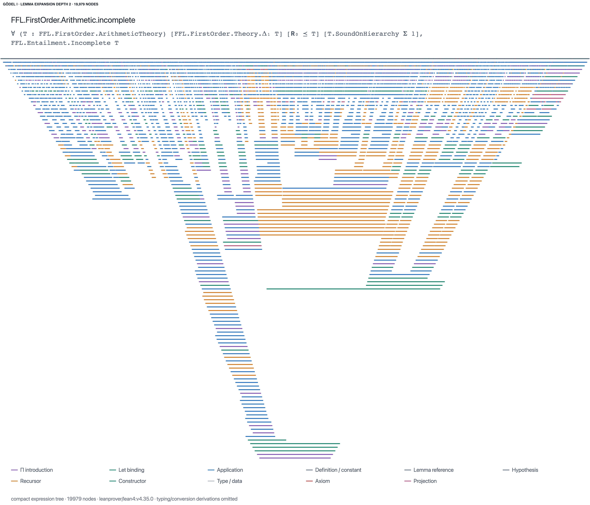

# Gödel's first incompleteness theorem



This figure comes from **`FFL.FirstOrder.Arithmetic.incomplete`** in the
[Foundation formalization](https://github.com/FormalizedFormalLogic/Foundation/blob/63bfd1b2e821dc2367b08f68d379303d08631f83/Foundation/FirstOrder/Incompleteness/First.lean).
It is the actual arithmetic incompleteness proof, including its diagonal construction
and applications of the representation theorem, with a bounded lemma-expansion policy.

This version assumes an arithmetic theory `T` is Δ₁-definable, extends R₀, and
is Σ₁-sound; it concludes `Incomplete T`. Its generic assumptions remain premises.
The image does not assert that this is the Rosser formulation assuming consistency
alone. Type/data arguments are hidden by the documented compact presentation policy.

## Recorded run

| Lemma expansion depth | Compact expression nodes | Truncated? |
| --- | ---: | --- |
| 0 | 467 | No |
| 1 | 2,646 | No |
| 2 | 19,979 | No |
| 3 | 100,000 (node cap) | **Yes** |

All four transformed closed terms passed Lean's kernel check. Their reported
axioms are `propext`, `Classical.choice`, and `Quot.sound`; none reports `sorryAx`.
These counts describe the chosen expression view with remaining dependencies folded.
They do not measure the theorem's minimum proof complexity or every kernel judgment.
A raw, unexpanded export hit the 100,000-node cap; the compact view makes the
proof structure easier to inspect.

Pins:

- Foundation: `63bfd1b2e821dc2367b08f68d379303d08631f83`.
- Mathlib: `56a005855ea17e0b0958f73ec801ae140b0a1679`.
- Lean: `leanprover/lean4:v4.35.0`.
- Formality: 0.4.0.
- Tree policy: `lean-expr/compact/v1`; normalization off; no specialization.
- Budgets: 100,000 output nodes, depth 500, 5,000,000 uncached transformation
  visits, 600 seconds. Depths 0–2 are complete. Depth 3 reached the output-node cap after about
  273 seconds and is explicitly truncated. The kernel check applies to its full
  transformed term; the drawing omits marked subtrees.
- Drawing: `inference-bars/v1`, taper 0.88, stroke 2.5.

## Reproduce

Clone Foundation next to Formality. No Foundation proof source needs modification.
Use its own published dependency and artifact cache before building the module:

```sh
git clone https://github.com/FormalizedFormalLogic/Foundation.git Foundation
cd Foundation
git checkout 63bfd1b2e821dc2367b08f68d379303d08631f83
lake exe cache get
LAKE_CONFIG=lake-cache.toml lake cache get --service ffl --max-revs=100 \
  --repo FormalizedFormalLogic/Foundation --package Foundation
lake build Foundation.FirstOrder.Incompleteness.First
cd ../Formality
formality export examples/foundation-godel.profile.json \
  --output runs/godel-depth-2 --write-lock runs/godel-depth-2.lock.json
```

The [profile](../examples/foundation-godel.profile.json) resolves its project path
relative to the profile file. Adjust it if the two checkouts live elsewhere.
Change `transform.expandDepth` to compare depths, and use a separate output folder
for each. The profile produces JSON/evidence and SVG; the viewer's Save PNG action
rasterizes an opened export. The displayed PNG uses that same SVG geometry with
an added banner identifying the expansion depth and node count.

The initial all-lemma expansion exceeded the prototype's fixed work limit.
Formality 0.4.0 memoizes transformations with structural keys that preserve binder
names, free-variable identities, dependency depth, and cycle guards. It also exposes
`maxVisits` so the larger work budget is part of the recorded recipe. Axiom and
kernel checks still apply to the transformed proof, not just the starting theorem.

Foundation is licensed under [Apache-2.0](https://github.com/FormalizedFormalLogic/Foundation/blob/63bfd1b2e821dc2367b08f68d379303d08631f83/LICENSE).
Formality's MIT license does not relicense the imported formalization. Credit for
the incompleteness formalization belongs to the Foundation contributors.
